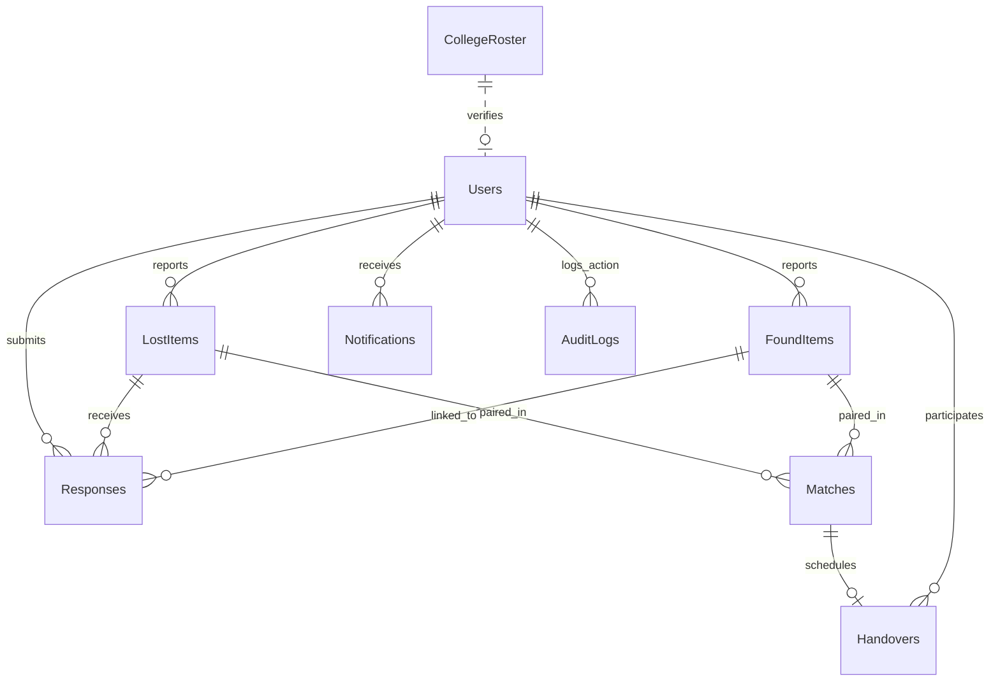

# CampusConnect – Database Schema Documentation

CampusConnect uses MongoDB with Mongoose ODM to model collections, relational references, indexes, and document lifecycles.

---

## 1. Entity-Relationship Diagram



---

## 2. Collection Definitions

### `users`
Represents registered students and administrative accounts.
```javascript
{
  collegeId: { type: String, required: true, unique: true, uppercase: true, index: true },
  name: { type: String, required: true, trim: true },
  email: { type: String, required: true, unique: true, lowercase: true, index: true },
  phone: { type: String, required: true, trim: true },
  department: { type: String, required: true, trim: true },
  academicYear: { type: String, required: true, trim: true },
  password: { type: String, required: true, select: false },
  role: { type: String, enum: ['student', 'admin'], default: 'student', index: true },
  accountStatus: { type: String, enum: ['ACTIVE', 'PENDING_APPROVAL', 'DEACTIVATED'], default: 'PENDING_APPROVAL', index: true },
  isCollegeVerified: { type: Boolean, default: false },
  createdAt: Date,
  updatedAt: Date
}
```

### `college_rosters`
Authorized university student records used to verify identity during registration.
```javascript
{
  collegeId: { type: String, required: true, unique: true, uppercase: true, index: true },
  name: { type: String, required: true, trim: true },
  email: { type: String, required: true, unique: true, lowercase: true, index: true },
  department: { type: String, required: true, trim: true },
  academicYear: { type: String, required: true, trim: true },
  verificationStatus: { type: String, enum: ['VERIFIED', 'PROVISIONAL', 'REVOKED'], default: 'VERIFIED' },
  isDemonstration: { type: Boolean, default: false },
  importedAt: { type: Date, default: Date.now }
}
```

### `lost_items`
Reports of belongings lost on campus.
```javascript
{
  studentId: { type: ObjectId, ref: 'User', required: true, index: true },
  itemName: { type: String, required: true, trim: true, index: true },
  category: { type: String, required: true, enum: ['ID Cards', 'Electronics', 'Personal Accessories', 'Books and Stationery', 'Bags', 'Clothing', 'Documents', 'Keys', 'Other'], index: true },
  description: { type: String, required: true, trim: true },
  lastSeenLocation: { type: String, required: true, trim: true, index: true },
  lostDate: { type: Date, required: true, index: true },
  lostTime: { type: String, trim: true },
  image: { type: String, default: '' },
  identifyingDetails: { type: String, trim: true, default: '' }, // Strictly private
  contactNumber: { type: String, trim: true, default: '' },      // Strictly private
  status: { type: String, enum: ['OPEN', 'UNDER_REVIEW', 'MATCHED', 'VERIFICATION_PENDING', 'APPROVED', 'REJECTED', 'RETURNED', 'CLOSED'], default: 'OPEN', index: true },
  adminRemarks: { type: String, trim: true, default: '' },
  closedReason: { type: String, trim: true, default: '' },
  createdAt: Date,
  updatedAt: Date
}
```

### `found_items`
Reports of belongings discovered on campus.
```javascript
{
  studentId: { type: ObjectId, ref: 'User', required: true, index: true },
  itemName: { type: String, required: true, trim: true, index: true },
  category: { type: String, required: true, enum: ['ID Cards', 'Electronics', 'Personal Accessories', 'Books and Stationery', 'Bags', 'Clothing', 'Documents', 'Keys', 'Other'], index: true },
  description: { type: String, required: true, trim: true },
  foundLocation: { type: String, required: true, trim: true, index: true },
  foundDate: { type: Date, required: true, index: true },
  foundTime: { type: String, trim: true },
  image: { type: String, default: '' },
  privateObservations: { type: String, trim: true, default: '' }, // Strictly private
  possessionStatus: { type: String, enum: ['Still with me', 'Deposited at admin office'], default: 'Still with me', index: true },
  status: { type: String, enum: ['AVAILABLE', 'UNDER_REVIEW', 'RESERVED', 'HANDED_OVER_TO_ADMIN', 'RETURNED', 'CLOSED'], default: 'AVAILABLE', index: true },
  adminRemarks: { type: String, trim: true, default: '' },
  closedReason: { type: String, trim: true, default: '' },
  createdAt: Date,
  updatedAt: Date
}
```

### `responses`
Claims from finders indicating they have found an item matching a lost report.
```javascript
{
  lostItemId: { type: ObjectId, ref: 'LostItem', required: true, index: true },
  foundItemId: { type: ObjectId, ref: 'FoundItem', default: null, index: true },
  responderId: { type: ObjectId, ref: 'User', required: true, index: true },
  message: { type: String, required: true, trim: true },
  description: { type: String, required: true, trim: true },
  foundLocation: { type: String, required: true, trim: true },
  foundDate: { type: Date, required: true },
  evidenceImage: { type: String, default: '' },
  status: { type: String, enum: ['PENDING', 'UNDER_REVIEW', 'ACCEPTED', 'REJECTED'], default: 'PENDING', index: true },
  adminRemarks: { type: String, trim: true, default: '' },
  createdAt: Date,
  updatedAt: Date
}
```

### `matches`
Candidate relationships evaluated by administrators.
```javascript
{
  lostItemId: { type: ObjectId, ref: 'LostItem', required: true, index: true },
  foundItemId: { type: ObjectId, ref: 'FoundItem', required: true, index: true },
  responseId: { type: ObjectId, ref: 'Response', default: null },
  adminId: { type: ObjectId, ref: 'User', required: true },
  matchScore: { type: Number, required: true, min: 0, max: 100 },
  matchingFactors: {
    nameScore: Number,
    categoryScore: Number,
    locationScore: Number,
    dateScore: Number,
    descriptionScore: Number
  },
  matchStatus: { type: String, enum: ['PENDING', 'UNDER_VERIFICATION', 'APPROVED', 'REJECTED', 'COMPLETED'], default: 'PENDING', index: true },
  remarks: { type: String, trim: true, default: '' },
  createdAt: Date,
  updatedAt: Date
}
```

### `handovers`
Physical handover appointments and chain of custody tracking at the College Admin Block.
```javascript
{
  lostItemId: { type: ObjectId, ref: 'LostItem', required: true, index: true },
  foundItemId: { type: ObjectId, ref: 'FoundItem', required: true, index: true },
  ownerId: { type: ObjectId, ref: 'User', required: true, index: true },
  finderId: { type: ObjectId, ref: 'User', required: true, index: true },
  adminId: { type: ObjectId, ref: 'User', required: true },
  collectionLocation: { type: String, default: 'College Admin Block', trim: true },
  scheduledAt: { type: Date, required: true },
  status: { type: String, enum: ['PENDING', 'SCHEDULED', 'COMPLETED', 'CANCELLED'], default: 'SCHEDULED', index: true },
  verificationMethod: { type: String, default: 'College ID and Physical Identifying Verification' },
  finderDepositedAt: { type: Date, default: null },
  handedOverAt: { type: Date, default: null },
  remarks: { type: String, trim: true, default: '' },
  cancellationReason: { type: String, trim: true, default: '' },
  createdAt: Date,
  updatedAt: Date
}
```

### `notifications`
Real-time database-backed in-app notifications.
```javascript
{
  recipientId: { type: ObjectId, ref: 'User', required: true, index: true },
  title: { type: String, required: true, trim: true },
  message: { type: String, required: true, trim: true },
  type: {
    type: String,
    enum: [
      'REPORT_SUBMITTED', 'RESPONSE_RECEIVED', 'ADMIN_REVIEWED',
      'VERIFICATION_REQUESTED', 'CLAIM_APPROVED', 'CLAIM_REJECTED',
      'COLLECTION_SCHEDULED', 'HANDOVER_COMPLETED', 'REPORT_CLOSED'
    ],
    required: true,
    index: true
  },
  relatedEntityType: { type: String, enum: ['LostItem', 'FoundItem', 'Response', 'Match', 'Handover', 'System'], default: 'System' },
  relatedEntityId: { type: ObjectId, default: null },
  isRead: { type: Boolean, default: false, index: true },
  createdAt: { type: Date, default: Date.now }
}
```

### `audit_logs`
Security audit log of administrative activities.
```javascript
{
  adminId: { type: ObjectId, ref: 'User', required: true, index: true },
  action: { type: String, required: true, trim: true, index: true },
  entityType: { type: String, required: true, trim: true, index: true },
  entityId: { type: ObjectId, default: null, index: true },
  description: { type: String, required: true, trim: true },
  createdAt: { type: Date, default: Date.now }
}
```

