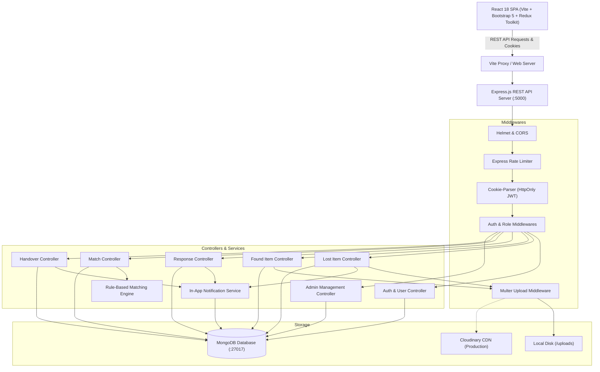

# CampusConnect – System Architecture Documentation

## 1. High-Level System Architecture

---

## 2. Security Architecture

1. **Authentication:**
   - Stateless JWT authentication tokens.
   - Stored in `HttpOnly`, `SameSite`, and `Secure` (in production) cookies, mitigating XSS token theft.
   - Secondary Bearer token fallback supported in request headers for resilient client communication.

2. **Authorization (RBAC):**
   - Two distinct roles: `student` and `admin`.
   - `protect` middleware decodes token and verifies account active status.
   - `authorize('admin')` restricts all management APIs.
   - Student ownership validation prevents students from editing or canceling other students' reports.

3. **Confidentiality of Secret Verification Data:**
   - In public browse listings, queries use Mongoose field exclusion: `.select('-identifyingDetails -contactNumber')`.
   - In single item retrieval, non-owners and non-admins receive sanitized JSON payloads via projection, protecting private phone numbers and identifying details from unauthorized claimants.

4. **Network & Header Hardening:**
   - Helmet sets HTTP headers (`X-Content-Type-Options`, `X-Frame-Options`, `Content-Security-Policy`).
   - Rate limiting (500 requests per 15 minutes window) defends against brute-force password guessing.
   - Input sanitization and validation using `express-validator`.

---

## 3. Weighted Matching Algorithm
Located in `server/services/matchingService.js`, the rule-based comparison engine calculates potential matches between a lost report and available found items using the exact specified weights:

$$\text{Match Score} = (0.30 \times S_{\text{name}}) + (0.20 \times S_{\text{cat}}) + (0.25 \times S_{\text{loc}}) + (0.15 \times S_{\text{date}}) + (0.10 \times S_{\text{desc}})$$

Where:
- **$S_{\text{name}}$ (30%):** Tokenized intersection over union with substring containment boost.
- **$S_{\text{cat}}$ (20%):** Strict category equality indicator ($100$ if identical, $0$ otherwise).
- **$S_{\text{loc}}$ (25%):** Keyword token similarity across campus zones (e.g. "Library 2nd Floor" vs "Library").
- **$S_{\text{date}}$ (15%):** Proximity decay function ($100$ for $\le 1$ day, $85$ for $\le 3$ days, $65$ for $\le 7$ days, $40$ for $\le 14$ days, $20$ for $\le 30$ days, $5$ beyond).
- **$S_{\text{desc}}$ (10%):** Stopword-filtered textual similarity.

The engine provides an administrative suggestion score, but never automatically approves ownership; admin human verification is strictly required.

